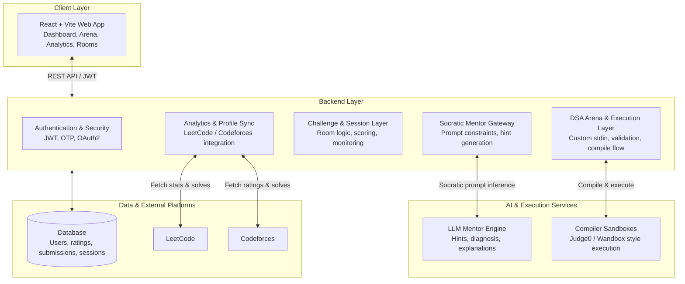

# AlgoMind 🧠⚡

AI-powered DSA learning platform for developers who want to think faster, solve smarter, and build real algorithmic confidence.

---

## Why AlgoMind exists

Most learners do not fail because they lack effort. They fail because they are learning in the wrong way.

They copy solutions from chatbots, memorize patterns without understanding them, and practice coding without a system that teaches reasoning. AlgoMind changes that.

AlgoMind is a modern learning platform built to help developers master Data Structures and Algorithms through guided feedback, adaptive learning, and structured practice.

Instead of giving away the full answer, AlgoMind teaches the way a strong mentor would:

- identify the right direction
- surface the key insight
- explain the tradeoff
- diagnose the bug
- reinforce the concept

That is the difference between memorization and mastery.

---

## The problem we solve

Traditional learning stacks are fragmented and inefficient.

Developers often move between:

- coding platforms with no personalized guidance
- generic AI tools that produce complete solutions instantly
- scattered analytics that do not tell them what to improve next
- practice workflows that lack structure, feedback, or accountability

The result is a common trap: low retention, weak intuition, and shallow confidence.

AlgoMind brings all of this together into one coherent system for serious skill development.

---

## What AlgoMind delivers

### 1. Socratic AI mentorship

A guided AI learning layer that helps users think through problems instead of handing them the final answer.

It supports:

- targeted hints
- reasoning-based nudges
- edge-case analysis
- complexity explanations
- debugging guidance

This creates a stronger learning loop: understand → reason → apply → improve.

### 2. DSA practice arena

An in-browser coding workspace built for serious learning.

Features include:

- Monaco-based editing experience
- multi-language compilation support
- custom stdin input
- test execution workflows
- structured practice and validation

This transforms practice from passive coding into active learning.

### 3. Adaptive skill intelligence

AlgoMind identifies weak areas and helps users focus on what matters most.

It tracks:

- topic mastery
- performance trends
- recurring mistakes
- weak algorithmic patterns

This enables personalized learning paths instead of random problem sets.

### 4. Collaborative challenge workflows

The platform supports structured challenge rooms and practice sessions for learners, peers, and teams who want a higher-intensity learning experience.

It makes learning more engaging, more measurable, and more motivating.

### 5. Motivation through progression

AlgoMind rewards progress with a rating and progression model that keeps users engaged.

This helps turn practice into momentum and momentum into consistent growth.

---

## Product vision

AlgoMind is not just another coding platform.

It is a learning system built for the next generation of developers who want to think clearly, solve confidently, and grow continuously.

Our mission is simple:

To turn algorithmic practice into skill-building, and skill-building into long-term developer confidence.

---

## High-level architecture



---

## Technology stack

### Frontend

- React 18
- Vite
- React Router
- Tailwind CSS
- Monaco Editor

### Backend

- Django
- Django REST Framework
- Django SimpleJWT
- PostgreSQL / SQLite

### AI and execution

- LLM-based Socratic mentor workflow
- compiler sandbox integration for execution and validation
- custom stdin handling and testing flow

### Integrations

- LeetCode and Codeforces profile sync
- Brevo and SMTP-based OTP delivery
- secure session and scoring infrastructure

---

## Repository structure

```text
.
├── Backend/                 # Django REST API backend
├── frontend/                # React frontend application
├── index.html               # root web entry / static asset entry
├── README.md                # project overview and setup guide
├── LICENSE                  # proprietary license
├── PRIVACY.md               # privacy policy
├── .gitignore
├── .vscode/
└── ...
```

---

## Local development setup

### Prerequisites

- Python 3.10+
- Node.js 18+
- npm and pip
- Chrome for local browser-based testing if needed

### 1. Backend setup

```bash
cd Backend
python -m venv venv

# Windows
venv\Scripts\activate

# macOS / Linux
source venv/bin/activate

pip install -r requirements.txt
cp .env.example .env
```

Then run:

```bash
python manage.py migrate
python manage.py runserver 127.0.0.1:8000
```

Backend URL:

- http://127.0.0.1:8000/

### 2. Frontend setup

```bash
cd frontend
npm install
npm run dev
```

Frontend URL:

- http://127.0.0.1:3000/

---

## Ideal user journey

### For self-learners

- create an account
- connect coding profiles and goals
- explore DSA topics
- solve problems in the practice arena
- get guided hints instead of instant answers
- improve through analytics and progression

### For teams and challenge-based learning

- create structured challenge sessions
- run timed problem workflows
- monitor progress and performance
- drive engagement through measurable outcomes

---

## Why this matters

The strongest developers are not the ones who copy the fastest.

They are the ones who can reason under pressure, debug under uncertainty, and improve systematically.

AlgoMind is built for that exact kind of growth.

---

## License

This project is proprietary software. See `LICENSE` for details.

For inquiries, contact: AlgoMind.Support@gmail.com

---

## Closing pitch

AlgoMind is the platform for developers who want to stop consuming solutions and start building real problem-solving ability.

It combines AI mentorship, coding practice, analytics, and progression into one product that makes learning sharper, faster, and more effective.

This is not just software.
This is a serious learning engine for the next generation of engineers.
