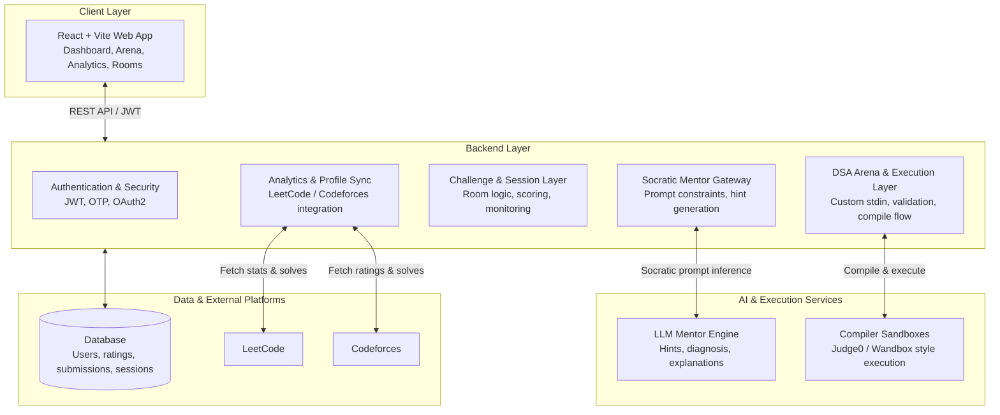

# AlgoMind 🧠⚡

Adaptive learning platform for DSA practice, mentorship, and intelligent coding workflows.

[](https://algomind-frontend-dvfp.onrender.com/)
[](https://github.com/god-the-coder/horizon-AlgoMind)
[](LICENSE)
[](PRIVACY.md)

---

## Overview

AlgoMind is a full-stack platform built to help learners and developers strengthen their Data Structures and Algorithms (DSA) skills through guided practice, adaptive learning, and structured coding workflows.

The platform combines:

- a Socratic AI mentor that gives hints instead of direct solutions
- a browser-based coding arena for problem solving and validation
- analytics for topic mastery and weak-area detection
- live challenge rooms for practice sessions and competitive workflows
- a progression system to keep users engaged and motivated

At a high level, AlgoMind addresses a common challenge in technical learning: many users rely on ready-made solutions instead of reasoning through the problem. The platform encourages understanding, debugging, and iterative improvement through targeted feedback and structured practice.

---

## Key Features

### 1. Socratic AI Mentor

Users can ask for help without receiving complete solution code. The AI focuses on:

- targeted hints
- reasoning nudges
- edge-case analysis
- complexity explanation
- debugging guidance

This helps learners build problem-solving instincts instead of copying finished answers.

### 2. DSA Practice Arena

The platform includes an in-browser coding environment with:

- Monaco-based editor experience
- multi-language compilation support
- custom stdin input
- test execution workflow
- structured challenge solving

### 3. Personalized Learning Analytics

Users can connect competitive programming profiles and track performance across topics such as:

- arrays
- trees
- graphs
- dynamic programming
- binary search
- greedy algorithms

The system surfaces gaps in mastery and supports adaptive learning paths.

### 4. Challenge Rooms and Live Sessions

AlgoMind supports guided practice sessions and competitive workflows with session controls, verification, and monitoring for structured coding environments.

### 5. Progression and Motivation

Users earn rating points and advance through levels as they complete practice tasks, study plans, and challenge-based activities.

---

## High-Level Architecture



---

## Technology Stack

### Frontend

- React 18
- Vite
- React Router
- Tailwind CSS
- Monaco Editor

### Backend

- Django
- Django REST Framework
- Django SimpleJWT
- PostgreSQL / SQLite

### AI & Execution

- LLM-based Socratic mentor flow
- Wandbox / Judge0-style execution gateway
- custom validation and stdin handling

### Integrations

- LeetCode and Codeforces profile sync
- Brevo / SMTP-based OTP delivery
- secure session and scoring infrastructure

---

## Repository Structure

```text
.
├── Backend/                 # Django REST API backend
├── frontend/                # React frontend application
├── index.html               # root web entry / static asset entry
├── README.md                # project overview and setup guide
├── LICENSE                  # proprietary license
├── PRIVACY.md               # privacy policy
├── .gitignore
├── .vscode/
└── ...
```

---

## Local Development Setup

### Prerequisites

- Python 3.10+
- Node.js 18+
- npm and pip
- Chrome for browser-based testing, if needed

### 1. Backend Setup

```bash
cd Backend
python -m venv venv

# Windows
venv\Scripts\activate

# macOS / Linux
source venv/bin/activate

pip install -r requirements.txt
cp .env.example .env
```

Configure your environment variables in `Backend/.env` as needed for:

- Django secret key
- allowed hosts
- database settings
- email OTP service
- compiler/execution service

Then run:

```bash
python manage.py migrate
python manage.py runserver 127.0.0.1:8000
```

The backend is available at:

- http://127.0.0.1:8000/

### 2. Frontend Setup

```bash
cd frontend
npm install
npm run dev
```

The frontend is available at:

- http://127.0.0.1:3000/

---

## User Flows

AlgoMind supports several learning and engagement patterns:

### Individual Learner

- sign up and create an account
- connect competitive programming handles
- review analytics and weak areas
- solve DSA problems in the arena
- request AI hints and debugging support
- track progress through ratings and goals

### Team / Challenge Workflow

- create or join structured practice sessions
- run timed coding challenges
- monitor progress and performance
- review challenge outcomes and analytics

### Host / Organization Workflow

- configure challenge rooms and session settings
- oversee participation and outcomes
- manage user progress and performance reporting

---

## Rating and Progression System

AlgoMind includes a lightweight internal rating engine to reward learning activity and performance.

- starting rating: 1000
- level progression: roughly every 500 rating points
- problem completions award rating gains
- study plan completion awards bonus points
- challenge results can award ranking-based bonuses

This keeps users motivated and provides a measurable path of improvement.

---

## License

Copyright © 2025–2026 Siddharth Garkoti. All rights reserved.

AlgoMind is proprietary software. The source code is made public here for portfolio review, architecture inspection, and demonstration purposes.

Usage, redistribution, and hosting are restricted without prior written permission.

For inquiries, contact: AlgoMind.Support@gmail.com

---

## Notes

This repository is structured as a portfolio-grade project and technical showcase. It is designed to communicate system architecture, product thinking, and implementation depth while also providing a working local development setup.

For a more contributor-oriented README, the next step would be to add:

- a clear contributor guide
- testing instructions
- API docs
- environment variable reference
- architecture notes per module
